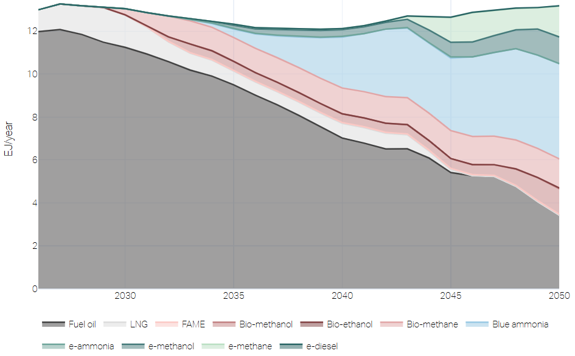

# Lantern

Lantern is a local web app that plots the results of
[Navigate](https://github.com/zerocarbonshipping/navigate-zcs), the
open-source maritime transition model. Every Navigate run writes a Parquet
results file; Lantern opens one or many of them, prepares the plots that
[`plots.yaml`](configs/plots.yaml) declares and serves them as interactive
Plotly figures to the browser. It can also write the same plots as HTML pages
and the raw rows as CSV without starting the viewer.

It is a small Python package with a static page of plain JavaScript and no
build step: Python 3.13+, Polars, Plotly, PyYAML and tqdm.



## Install

```bash
pip install lantern-zcs
```

## Use

```bash
lantern my_run.parquet          # opens the viewer on that run
lantern study/                  # every .parquet below study/
lantern --data my_run.parquet   # Export plot data to .csv
lantern --list my_run.parquet   # print the runs and ids of the plots with data
lantern --plot 'fleet_speed' e2e.parquet  # generate the fleet speed plot .html

# Example Custom Plot Exports
lantern --plot 'fleet_speed[e2e/none_main,e2e/nzf_main]' my_run.parquet   
lantern my_run.parquet \
    --plot 'main_emission_absolute' \
    --plot 'main_fuel_consumed_stacked' \
    --plot 'main_fuel_type_consumed[][METHANE]'
```

| Argument | Meaning |
|---|---|
| `PATH ...` | results files, or folders; a folder loads every `.parquet` file in it and below, named by its path in the folder |
| `--plot ID[RUN,...][PANEL]` | no viewer: write a plot as an interactive HTML page, see [Writing plots](#writing-plots) |
| `--list` | no viewer: print the loaded runs and the id, section, title and panels of every plot with data, for `--plot` |
| `--data` | no viewer: write every row of the files, with a `run` column, as `data.csv` in the current folder |
| `-h`, `--help` | the arguments |

The switches combine: `--data --plot ID` writes both. Errors, a missing path, a
file that is not a results file, a bad YAML value, an unknown plot, run or
panel, print `Error: ...` and exit with 1. The viewer listens on
`127.0.0.1:8050`, or a free port when that is taken, and opens the browser.

### Writing plots

`--plot` saves a plot as an HTML page in `plots/`, as the viewer first shows
it (a plot with views in its first view). Repeat it for more plots; Lantern
prints the paths it wrote.

- `--plot ID`: the plot of each run, `plots/<run>/<ID>.html`.
- `--plot 'ID[RUN,RUN]'`: those runs together in one figure,
  `plots/<ID>/<run>+<run>.html`. Name the runs as `--list` prints them, e.g.
  `e2e/nzf_main`.
- `--plot 'ID[RUN][PANEL]'`: only that panel, enlarged, with `_<PANEL>` added
  to the file name; `ID[][PANEL]` for each run. Name the panel by its key from
  `--list` or by its title.

File names use a run's name within its file, `nzf_main`, or its full id with
`_` for `/` where two files have a run of that name. An unknown plot or run is
an error; a plot without data is skipped, and Lantern says which. The pages
load plotly.js from the internet. Quote the bracket forms in shells that expand
`[]`, such as zsh.

## Configuration

Three YAML files. The catalogue is the user's and travels with a study; the
other two are part of the package.

| File | Where | What it holds | Manual |
|---|---|---|---|
| `plots.yaml` | the folder Lantern is started in, or, if there is none, the home folder; this repository's is [`configs/plots.yaml`](configs/plots.yaml) | the catalogue: every plot's series, layers, panels, views, unit and axis, grouped in sections. `customize_runs` names runs and fixes their colours; `labels` and `theme` override entries of the two files below | [`configs/README.md`](configs/README.md) |
| [`lantern/labels.yaml`](lantern/labels.yaml) | the package | the display name and colour name of each label that tells series apart (fuels, fleets, plants, ...); the order of listing is the stacking and panel order | header of the file |
| [`lantern/theme.yaml`](lantern/theme.yaml) | the package | the Center's colours: eight palettes in shades 0 to 8, such as `blue_5`, the palette for labels and runs without a colour, and the figures' font | header of the file |

Without a `plots.yaml` in either place Lantern stops and says so.

A series in `plots.yaml` is `kind.attribute`, e.g. `fleet.newbuilds`. What
can be plotted is what the results file holds: Navigate's reference manual
lists every series in that form, with its unit and keys, under
[Results file: Results](https://zerocarbonshipping.github.io/navigate-zcs/staging/reference_manual/results_file.html#results).

The split is deliberate: `plots.yaml` says *what* is plotted and nothing
about looks, apart from the overrides; `labels.yaml` says what the series are
called and in which order and colour name they come; `theme.yaml` says what a
colour name is.

Lantern checks all three at start and on Refresh and stops at a mistake with
the file and line, the plot or the label; the
[rules of thumb](configs/README.md#rules-of-thumb) list what it checks.


## Disclaimer

Lantern is an open-source analytical tool intended for research and scenario
analysis of maritime decarbonisation pathways. Its outputs depend on the
model, assumptions, and data selected by the user and are provided for
illustrative and analytical purposes only. They should not be interpreted as
forecasts, benchmarks, recommendations or commercially optimal outcomes, nor
as legal, financial or investment advice. Users are responsible for
selecting appropriate assumptions and for exercising their own independent
judgement when interpreting any outputs.

## License

Copyright 2026 Fonden Mærsk Mc-Kinney Møller Center for Zero Carbon Shipping.

The `lantern` package and all build and tooling files are licensed under the
[Apache License 2.0](LICENSES/Apache-2.0.txt) (see also [LICENSE](LICENSE));
the documentation under [CC-BY-4.0](LICENSES/CC-BY-4.0.txt). Every file
declares its license through an `SPDX-License-Identifier` header or
[REUSE.toml](REUSE.toml), following the [REUSE specification](https://reuse.software/).
